# ShopLite 3-Tier AWS Deployment

**Name:** Md. Rubaiyat Rahim 
**Batch:** DevOps Batch 14 
**Assignment Title:** Deploy a Containerized 3-Tier Application on AWS EC2 

## Project Overview

ShopLite is a containerized 3-tier e-commerce catalog application deployed on AWS EC2. The architecture utilizes Docker containers pulled directly from Docker Hub, a custom VPC with public and private subnets, and strict Security Group rules enforcing least privilege. The database is completely isolated from the public internet in a private subnet, with data persistence managed via Docker volumes.

## Architecture Diagram

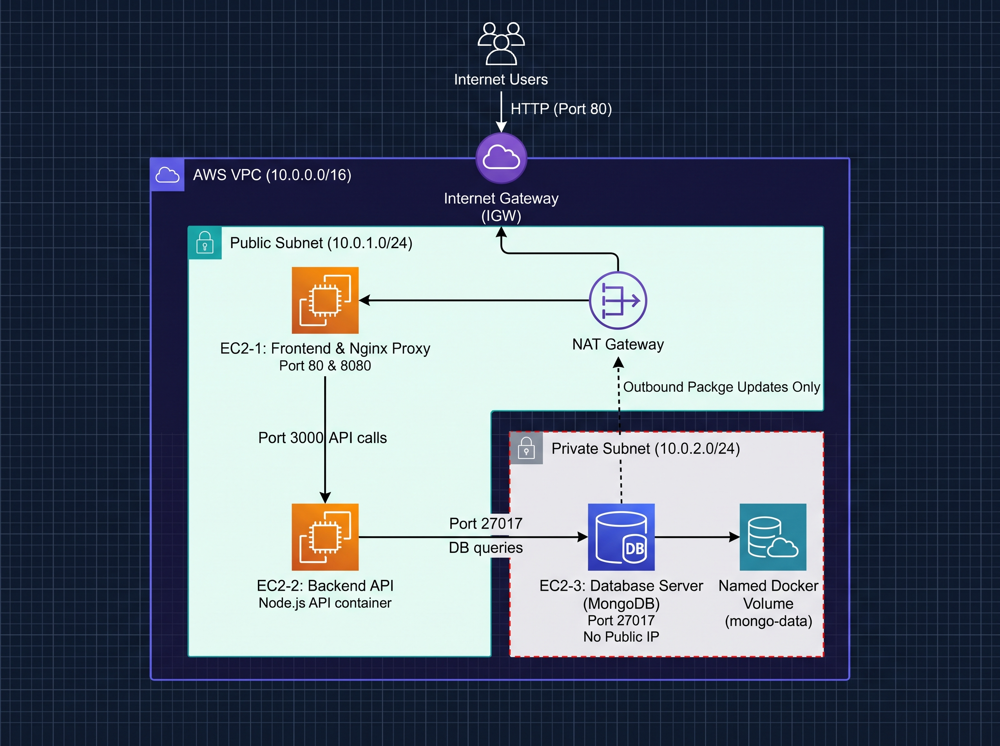

## Docker Hub Images

- **Frontend:** [https://hub.docker.com/repository/docker/rubaiyatrahim/shoplite-backend]
- **Backend:** [https://hub.docker.com/repository/docker/rubaiyatrahim/shoplite-frontend]

## Deployment Process

1. **Network Provisioning:** Created a VPC (`10.0.0.0/16`) with a Public Subnet for the frontend/backend and a Private Subnet for the database. Configured an IGW for public routing and a NAT Gateway to allow the private database to securely pull images.
2. **Security Groups:** Configured `Frontend-SG` (Port 80 from `0.0.0.0/0`), `Backend-SG` (Port 3000 restricted to `Frontend-SG`), and `Database-SG` (Port 27017 restricted to `Backend-SG`).
3. **Compute Provisioning:** Launched three Ubuntu EC2 instances. EC2-1 and EC2-2 in the public subnet; EC2-3 in the private subnet without a public IP.
4. **Database Deployment:** SSH'd into EC2-3 (via Bastion jump on EC2-1). Created a user-defined Docker network and a named Docker volume (`mongo-data`). Ran the official MongoDB container attached to this volume for persistence.
5. **Backend Deployment:** SSH'd into EC2-2. Created a Docker network and ran the Node.js API container, passing EC2-3's private IP into the `MONGO_URI` environment variable.
6. **Frontend & Proxy Deployment:** SSH'd into EC2-1. Created a Docker network and ran the Vanilla HTML frontend container on port 8080. Installed Nginx directly on the host OS and configured it as a reverse proxy to route `/` to the frontend container and `/api/` to EC2-2's private IP over the AWS network.

## Part E: Scenario-Based Questions

**Q1. The page loads, but the product list is empty and the browser shows "502 Bad Gateway" for every API call. Explain how you would find and fix the root cause.**
A "502 Bad Gateway" means the Nginx proxy on EC2-1 is functioning, but cannot forward the request to the API on EC2-2. I would SSH into EC2-1 and check `/var/log/nginx/error.log` to confirm the connection drop. Next, I would SSH into EC2-2 and run `docker ps` to verify the backend container hasn't crashed. If the container is running, the issue is network-related. I would verify `Backend-SG` allows port 3000 from EC2-1, and ensure the `proxy_pass` IP in the Nginx config matches EC2-2's actual private IP.

**Q2. The security team asks you to install an OS security patch on the database server. Explain how the patch will reach EC2-3 without breaking the security rule.**
Because EC2-3 is in a Private Subnet routed to a NAT Gateway, it can initiate outbound requests to the internet without requiring a public IP. I would SSH into EC2-1 (acting as a Bastion Host) and jump to EC2-3. Once inside, running `sudo apt update && sudo apt upgrade` will securely download the patches through the NAT Gateway, completely bypassing direct inbound internet exposure.

**Q3. A developer pushed a new backend image and now adding a product fails for every user. The CTO wants the old version back within 2 minutes. Explain what you would do.**
Because the deployment uses strict version tags (`v1.0.0`) rather than the `latest` tag, rollback is immediate. I would SSH into EC2-2, remove the broken container (`docker rm -f backend-api`), and spin up a new container using the exact same run command but pointing to the previous, stable image tag. The API would be restored in seconds without rebuilding code.

**Q4. A teammate opens the database port to 0.0.0.0/0 "just for testing" and forgets about it. Explain the impact and how your design should prevent this.**
Exposing a database port to `0.0.0.0/0` risks brute-force attacks and data theft from the public internet. However, this architecture prevents disaster because EC2-3 resides in a Private Subnet. The AWS Internet Gateway has no route to send outside traffic to it, and it has no public IP to address. Even with a compromised Security Group, the internet cannot physically reach the instance.

**Q5. After the demo, traffic grows 10 times. Explain which tier will fail first, why, and what you would change in this architecture.**
The Frontend (EC2-1) or Backend (EC2-2) tiers will fail first, as they are single instances acting as bottlenecks. Under a 10x load, Nginx will exhaust connections and the Node.js process will max out CPU/memory and crash. To fix this, I would decouple the tiers into Auto Scaling Groups (ASGs). I would place a public Application Load Balancer in front of multiple EC2-1 instances, and an internal load balancer for EC2-2, scaling horizontally across Availability Zones.

## Required Screenshots

### 1. Running Application

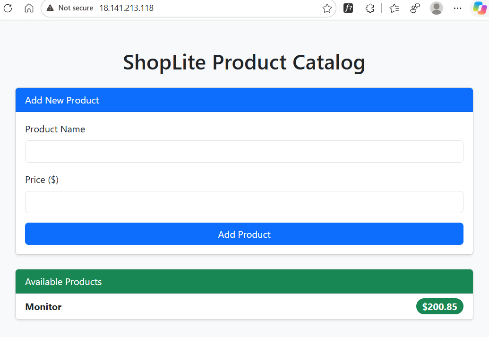
_Product persists across refreshes._

### 2. Docker Status & Networks (EC2-1 Frontend)

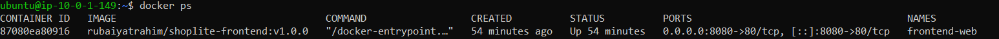
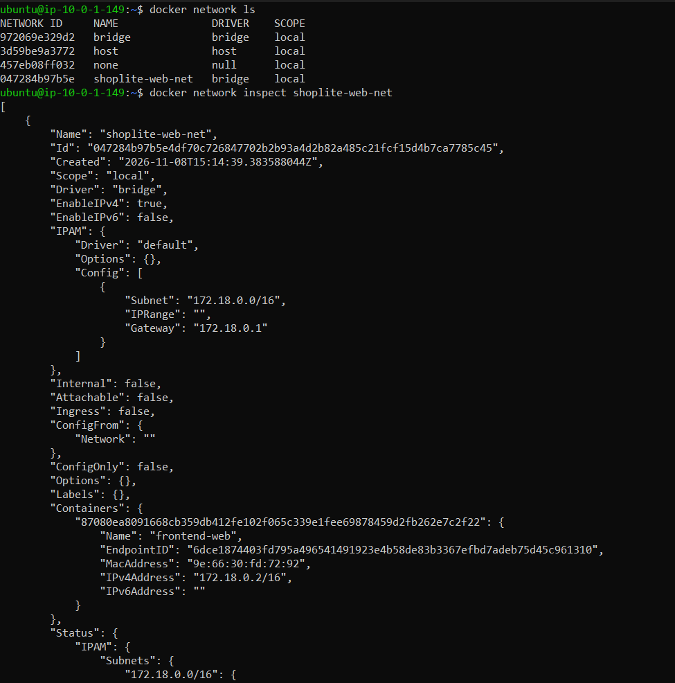

### 3. Docker Status & Networks (EC2-2 Backend)

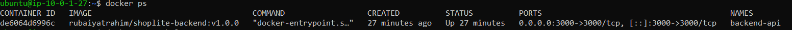
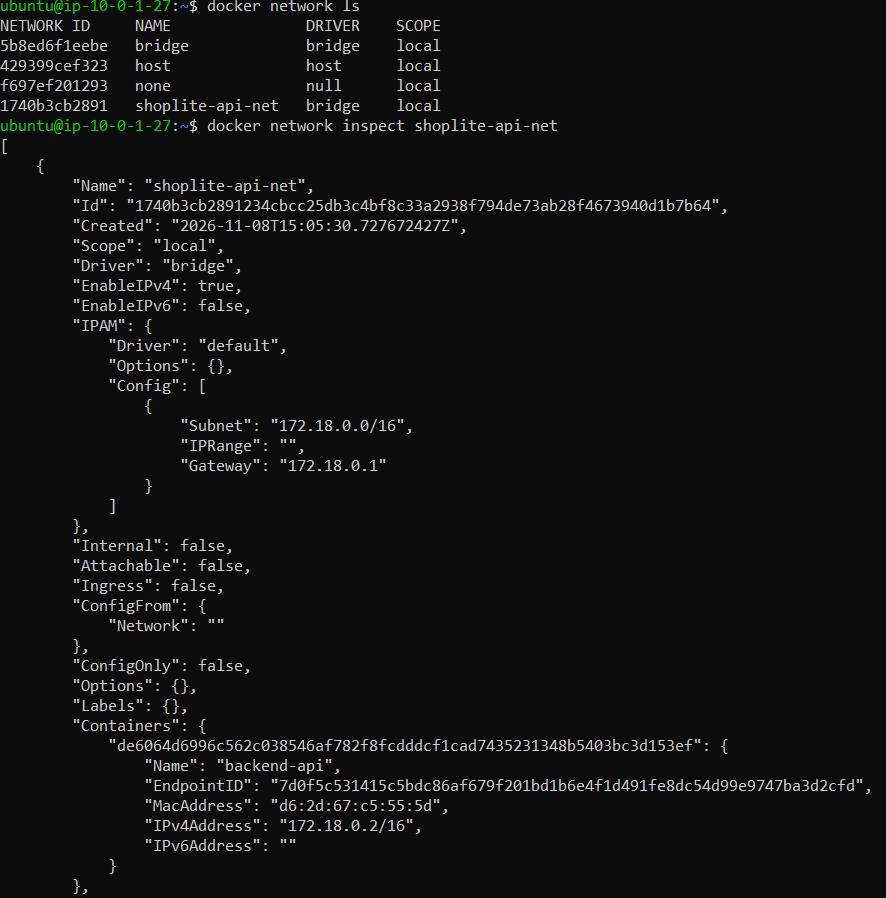

### 4. Docker Status & Networks (EC2-3 Database)

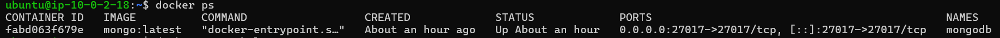
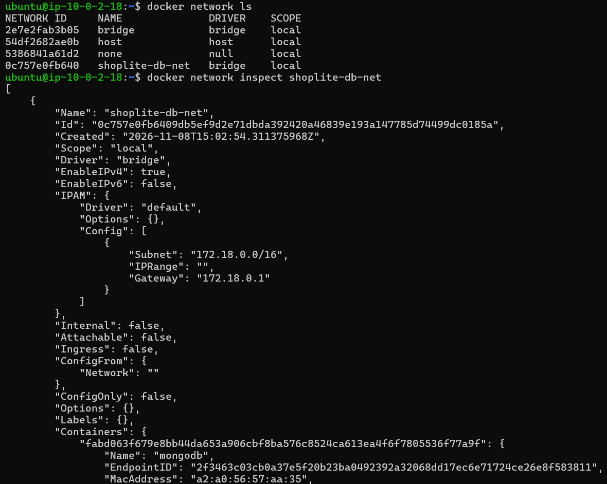

### 5. Docker Volume Proof (EC2-3)

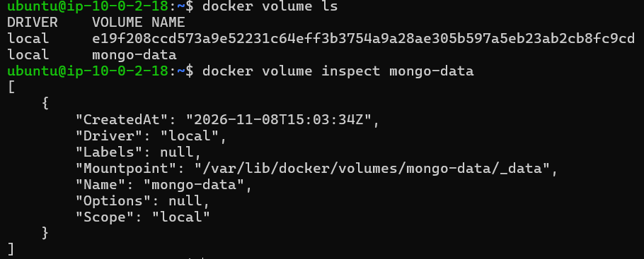

### 6. Security Group Inbound Rules

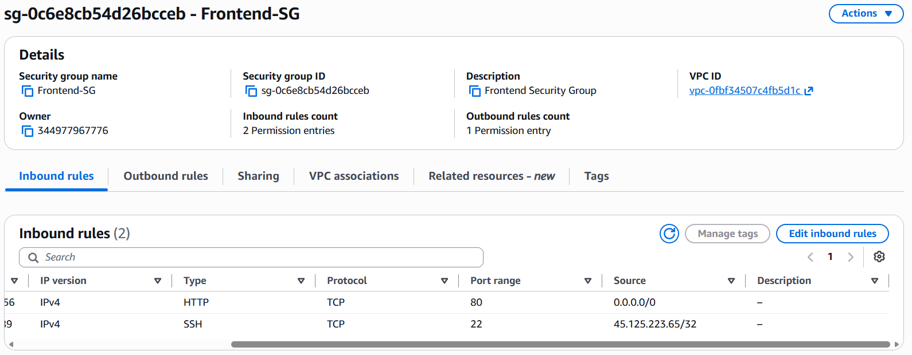
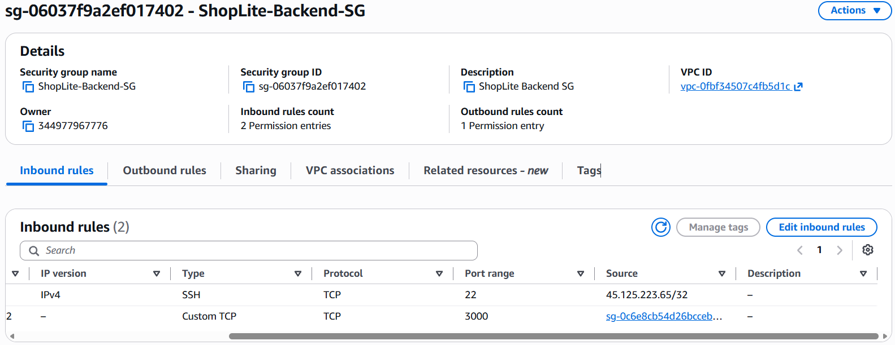
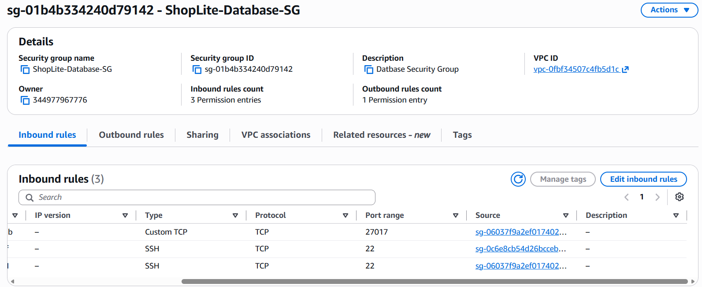

### 7. EC2-3 Isolation Proof

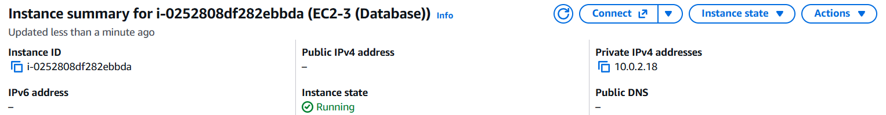
_Confirming no public IPv4 address is assigned._

### 8. Data Persistence Proof

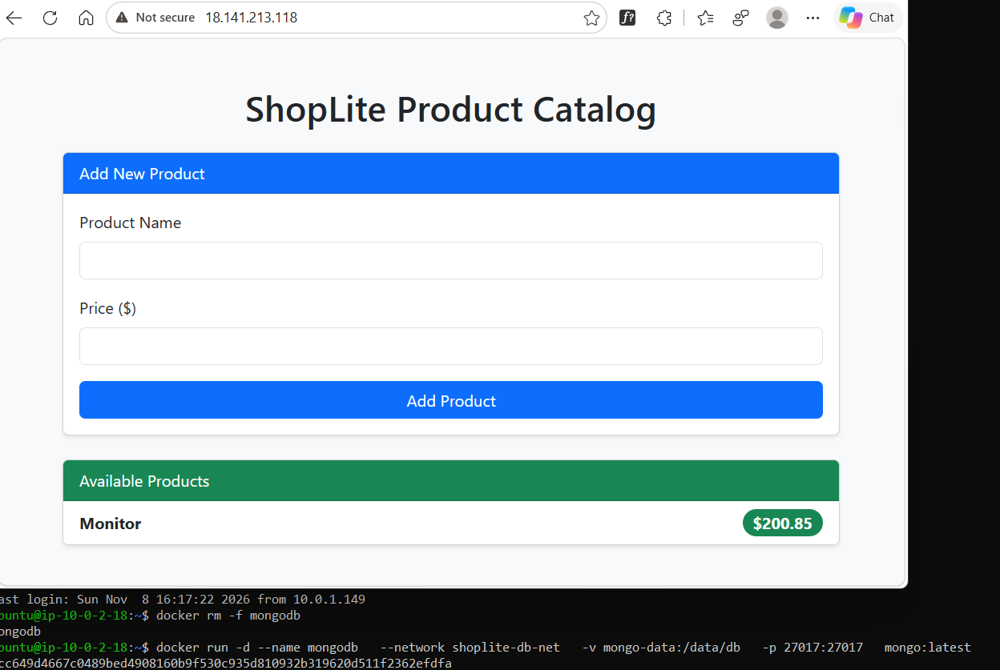
_Product catalog successfully loading after `docker rm -f mongodb` and container restart._
